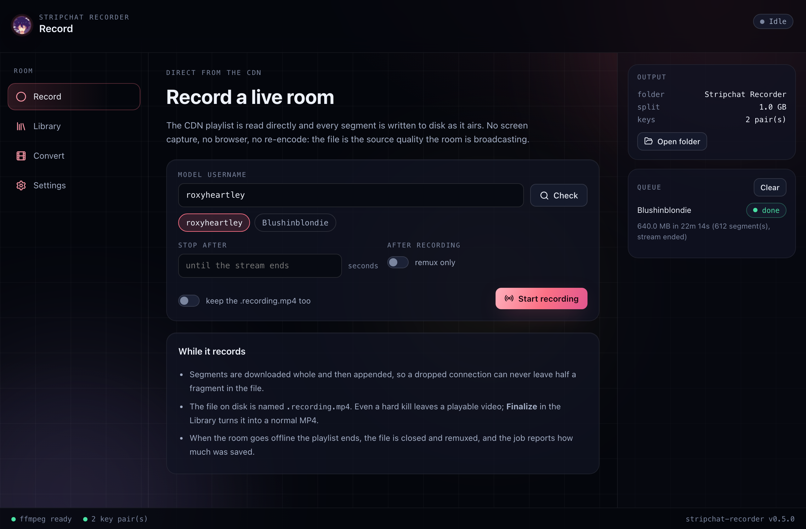
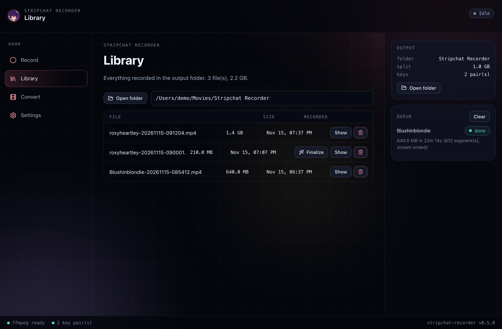

# Stripchat Recorder

[](https://ghostyshell.github.io/stripchat-record/)
[](https://discord.gg/d3sFnrgpJn)
[](https://ko-fi.com/ghosty99)
[](https://etherscan.io/address/0xbBef115aD853236a350EaF04777a2AdB2e7c0317)

Record Stripchat live rooms at source quality, straight from the CDN. No screen
capture, no browser, no re-encode: the app pulls the site's own HLS playlist,
downloads every segment as it airs and writes it to disk.

Built with a Rust engine, Tauri 2 and React.

| Record | Library |
| --- | --- |
|  |  |

## Download

<!-- downloads:start -->
| Build | Download | Size |
| --- | --- | --- |
| `stripchat-recorder-0.5.3-arm64.dmg` | [Download](https://covers.debrid.in/stripchat-recorder/releases/0.5.3/stripchat-recorder-0.5.3-arm64.dmg) | 5.6 MiB |
| `stripchat-recorder-cli-0.5.3-macos-arm64.tar.gz` | [Download](https://covers.debrid.in/stripchat-recorder/releases/0.5.3/stripchat-recorder-cli-0.5.3-macos-arm64.tar.gz) | 1.6 MiB |
<!-- downloads:end -->

The desktop builds are not notarized: right-click, Open, Open on first launch
(or `xattr -dr com.apple.quarantine "/Applications/Stripchat Recorder.app"`).

## Guides

Step-by-step walkthroughs live in [docs/guides](docs/guides/index.md):

1. [Install](docs/guides/install.md)
2. [Recording a room](docs/guides/recording.md)
3. [Library and conversion](docs/guides/library-and-conversion.md)
4. [Troubleshooting](docs/guides/troubleshooting.md)
5. [Build from source](docs/guides/build-from-source.md)

## What it does

- **Record a live room**: type the username, check it is live, pick the source
  variant, record. Every segment is written as it airs.
- **Source quality only**: the app reads the CDN's own playlist and saves the
  fMP4 fragments unchanged, so the file is exactly what the room broadcasts.
- **Split parts**: rotate to a new file at a size you choose (1 GB by default)
  without breaking the video, each part carries its own init segment.
- **Library**: every recording in one list with size and date; reveal it in the
  file manager or delete it.
- **Convert and compress**: remux to a clean MP4, or re-encode with H.264 or
  H.265 CRF presets, the same ones the rip tools use.
- **Crash-safe by construction**: a segment is only appended once it is whole,
  so a dropped connection or a hard kill cannot leave a broken file.

## How it records

The recorder never touches a browser: it speaks HLS to the CDN directly. That
is why it can record a room that is playing nowhere, and why the output has no
chat, overlays or player chrome in the picture.

Stripchat hides its segment paths behind a rotating `pkey`/`pdkey` pair
(MOUFLON v2). Two known pairs ship with the app; when the site rotates them,
the CDN serves the advert playlist and the app says so. Add a fresh pair in
Settings, or set `PD_KEY_<n>=<pkey>:<pdkey>` in the environment.

## Requirements

- **ffmpeg** on `PATH` for the final remux and for compression (the app works
  without it: the recorded file still plays, it is just not remuxed).
- A connection that can reach the CDN. Some addresses are refused by the site
  API; there is a proxy setting for that.

## Build from source

Requirements: Rust 1.85+, Node 20+, and the Tauri 2 prerequisites for your
platform (Xcode CLT on macOS, MSVC + WebView2 on Windows, webkit2gtk-4.1 on
Linux). The full walkthrough is in
[docs/guides/build-from-source.md](docs/guides/build-from-source.md).

```sh
npm install --prefix app
cargo build --release -p stripchat-recorder-cli        # CLI
npx --prefix app tauri build                # desktop bundles
```

Dev without a network:

```sh
npm run --prefix app dev:mock   # UI with fixture data (?mock=1)
```

CLI quick tour:

```sh
stripchat-recorder record MODEL --duration 60          # record for a minute
stripchat-recorder record MODEL --split-size 1G        # rotate at 1 GiB (the default)
stripchat-recorder record MODEL --output-dir ~/Videos  # choose the folder
stripchat-recorder presets                             # conversion presets
stripchat-recorder convert file.mp4 --preset h265_balanced
stripchat-recorder library                             # what has been recorded
stripchat-recorder doctor                              # ffmpeg, folder, API
```

## Architecture

```
core/            stripchat-core: the engine (site client, HLS parsing, the
                 recording loop and its append-only writer, ffmpeg, jobs)
cli/             stripchat-recorder headless CLI (clap)
app/             Tauri 2 desktop app: React 18 + TypeScript frontend,
                 commands in app/src-tauri, events for job progress
```

See [DESIGN.md](DESIGN.md) for the design system and
[docs/features.md](docs/features.md) for the feature reference.

## License

MIT.
